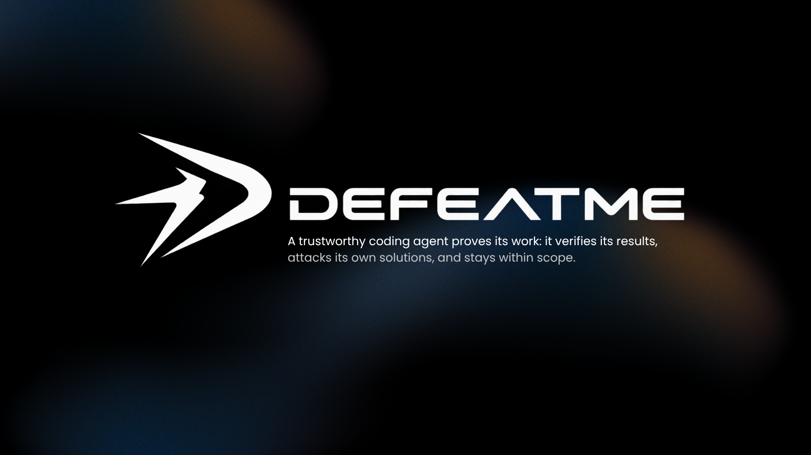

# defeat-me



**Make your agent prove its work.**

defeat-me is a public collection of Agent Skills that help coding agents verify changes, challenge their own solutions, and stay within the requested scope.

## Skills

| Skill | What it does | Use it when |
|---|---|---|
| [defeat-done](skills/defeat-done/SKILL.md) | Requires real test, build, and lint results; asks the agent to probe edge cases and report what remains unverified. | Implementing a change or fixing a bug. |
| [defeat-hallucinations](skills/defeat-hallucinations/SKILL.md) | Checks package names and version-specific APIs against installed code, types, lockfiles, and official documentation before use. | Adding an unfamiliar dependency or API. |
| [defeat-scope](skills/defeat-scope/SKILL.md) | Keeps diffs focused, preserves existing edits, and requires a file-by-file change summary. | Making changes in an existing codebase. |

Each skill is a self-contained `SKILL.md` in the open [Agent Skills](https://agentskills.io) format.

### What changes in practice

**`defeat-done`**

- Before: “The fix should work now.”
- After: “`npm test` passed (18 tests); `npm run build` passed; lint was not run because this project has no lint script. The empty-input regression test failed before the fix and passes now.”

**`defeat-hallucinations`**

- Before: “I'll install this package and use its API from memory.”
- After: “I could not verify the package name or API in the configured registry, installed dependencies, or an official source, so I did not install or use it.”

**`defeat-scope`**

- Before: “I fixed validation and reformatted the surrounding module.”
- After: “Changed `src/validate.ts` for the requested validation and `src/validate.test.ts` for its regression test. No unrelated refactoring or files changed.”

## Install and use

### GitHub Copilot in VS Code

1. Open the Chat view with **Copilot** as the session target.
2. Run **Chat: Install Plugin From Source** from the Command Palette.
3. Enter `https://github.com/cceyn/defeat-me` and confirm the source.
4. Ask Copilot to perform a coding task, or name the workflow you want, for example: `Use defeat-done to verify this change before you finish.`

In a Copilot harness session, you can also run:

```text
/plugin install https://github.com/cceyn/defeat-me
```

Plugin support must be enabled in VS Code (`chat.plugins.enabled`).

Once installed, the skills are available to Copilot and may be selected when relevant. Skill discovery does not guarantee that an agent invokes a skill for every matching request. You can also open a skill's `SKILL.md` from the links above and follow it manually.

### Other compatible agents

The three skills use the portable Agent Skills format. Other compatible agents can use them if they support skills and discover or are configured to load the repository's `skills/` directory. Supported locations and installation steps vary by agent; consult that agent's documentation.

## Optional Copilot completion hook

The plugin includes a Copilot-specific hook. It is separate from the portable skills and is **off unless a project explicitly enables it**. VS Code documents agent hooks as Preview.

To enable it for a project, create `.defeat-me.json` in that project's root and provide its actual test command:

```json
{
  "enabled": true,
  "testCommand": "npm test"
}
```

At each main-agent completion attempt, the hook runs the configured `testCommand` through the platform shell from the project root. A non-zero exit, invalid configuration, or inability to start the command blocks that attempt and reports an error, plus up to the last 6,000 characters of combined output on failure. The command has a 110-second timeout; the hook has a 120-second timeout. The configured command runs with the Copilot process's permissions and environment, so only enable it for a project you trust.

The hook requires Node.js available as `node`. It runs `node "${PLUGIN_ROOT}/scripts/verify-tests.cjs"`; the verifier reads the hook event from standard input and `.defeat-me.json` from the current project root. It does not install dependencies, inspect package manifests, or guess a test framework. To disable the check, change `"enabled": true` to `"enabled": false` in `.defeat-me.json`. See the [Copilot hooks reference](https://docs.github.com/en/copilot/reference/hooks-reference) and [the verifier source](scripts/verify-tests.cjs).

## Project contents

```text
skills/
  defeat-done/SKILL.md
  defeat-hallucinations/SKILL.md
  defeat-scope/SKILL.md
```

The repository also contains the plugin manifest and optional Copilot hook. `.github/` holds GitHub issue and pull request templates; those are repository-maintenance files, not installable skills.

## Contributing

Keep changes focused, portable, and verifiable. See [CONTRIBUTING.md](CONTRIBUTING.md).

## License

MIT. See [LICENSE](LICENSE).

## Links

- [GitHub repository](https://github.com/cceyn/defeat-me)
- [Agent Skills standard](https://agentskills.io)
- [VS Code Agent Plugins authoring reference](https://code.visualstudio.com/docs/agents/reference/agent-plugin-reference)
- [VS Code Agent Skills guide](https://code.visualstudio.com/docs/agent-customization/agent-skills)
